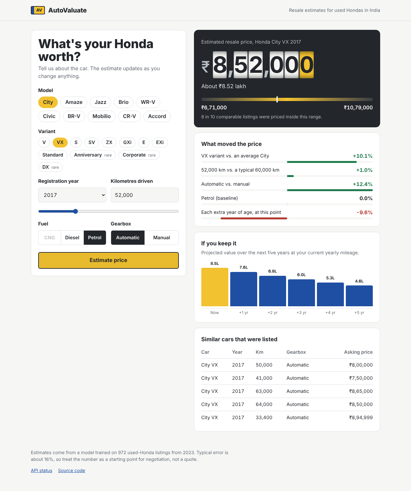

# AutoValuate

AutoValuate tells you roughly what a used Honda is worth in the Indian market. You pick the model, the variant, the year, how far it has been driven, the fuel and the gearbox, and it gives you a price, a realistic range around that price, the reasons behind the number, how the value will drop if you keep the car, and five real listings that look like yours.

This is version 2. Version 1 was a Streamlit app with a Linear Regression model. Version 2 runs on Cloudflare Workers, has a rebuilt interface, and uses a better model that covers the full price range instead of cutting off at ₹10 lakh.



---

## What changed from v1

If you only read one section, read this one. The full write-up with reasoning is in [docs/REVIEW.md](docs/REVIEW.md).

| | v1 (Streamlit) | v2 (Cloudflare) |
|---|---|---|
| Hosting | Streamlit Community Cloud. The app sleeps when idle and takes 30+ seconds to wake up | Cloudflare Workers. Always on, served from 300+ cities, free tier covers 100,000 requests a day |
| Model | `LinearRegression` on raw price, pickled | Ridge regression on log(price), exported to JSON |
| Price range covered | Only cars under ₹10 lakh (expensive cars were removed before training) | Every car in the dataset, ₹45k to ₹26.5 lakh |
| Accuracy (5-fold CV, same clean data) | R² 0.80, average error ₹83,160 | R² 0.88, average error ₹70,456 |
| Negative prices | Possible (7 cars got a negative price in testing) | Impossible, because the model predicts the logarithm of the price |
| Car variants | First three words of the name, so "City i VTEC" and "City i DTEC" became a variant called "Honda City i" | Proper model and trim (V, VX, ZX, …) extracted from the name |
| What you see | A single number | Price, likely range, what moved the price, five-year value projection, similar real listings |
| Tests | None | Automatic check that the website's maths matches the Python model exactly |

---

## Run it on your computer in five minutes

You need [Node.js](https://nodejs.org) 20 or newer. Python is only needed if you want to retrain the model.

```bash
npm install        # installs Wrangler, Cloudflare's command-line tool
npm run dev        # starts the site at http://localhost:8787
```

Open http://localhost:8787 and try it. To put it on the internet:

```bash
npx wrangler login # opens a browser so you can sign in to Cloudflare (free account is fine)
npm run deploy     # prints your live URL, something like https://autovaluate.<you>.workers.dev
```

That's the whole deployment. The longer version, with retraining, custom domains, automatic deploys from GitHub and fixes for common problems, is in [docs/SETUP.md](docs/SETUP.md).

---

## How it works

```
                       Your browser
                            │
            ┌───────────────┴────────────────┐
            │ index.html, styles.css, app.js │  ← plain files from /public,
            └───────────────┬────────────────┘    cached at Cloudflare's edge
                            │  POST /api/predict
                            ▼
                 Cloudflare Worker (src/index.js)
                            │
                  src/model.js  +  src/data/model.json
                  (≈30 lines of maths + the trained weights)
```

The model is trained in Python (`ml/train.py`) the normal way with scikit-learn. Instead of saving a pickle file, the script writes the learned weights into `src/data/model.json`. A Ridge regression is just "start from a base number and add a weight for each feature", so the Worker can do the same calculation in JavaScript with no Python, no scikit-learn and no server to keep running. A test (`npm test`) checks that the JavaScript gives the same answer as Python for 40 sample cars.

More detail on each piece is in [docs/ARCHITECTURE.md](docs/ARCHITECTURE.md), and the API is documented in [docs/API.md](docs/API.md).

---

## Project layout

```
autovaluate/
├── public/                 the website (no build step, edit and refresh)
│   ├── index.html
│   ├── styles.css
│   ├── app.js
│   └── favicon.svg
├── src/                    the Cloudflare Worker
│   ├── index.js            routes: /api/health, /api/meta, /api/predict
│   ├── model.js            prediction, explanation, projection, similar cars
│   └── data/
│       ├── model.json      generated by ml/train.py — don't edit by hand
│       └── listings.json   generated by ml/train.py — cleaned listings
├── ml/
│   ├── train.py            clean data → train → evaluate → export JSON
│   ├── requirements.txt
│   ├── data/honda_car_selling.csv
│   └── notebooks/original_analysis.ipynb   the v1 notebook, kept for reference
├── test/
│   ├── model.test.js       JS vs Python parity + validation tests
│   └── fixtures.json       generated by ml/train.py
├── docs/                   setup guide, review, roadmap, API, architecture
├── .github/workflows/deploy.yml   test on every push, deploy on main
├── wrangler.jsonc          Cloudflare configuration
└── package.json
```

---

## Honest limits

The model learned from about 1,000 listings scraped in 2023. That's enough to be useful and not enough to be precise. On average it's about 16% off, and the range shown on the page is wide on purpose: 8 out of 10 real listings fell inside it during testing. It only knows Honda, only knows Indian prices, and doesn't know about the car's condition, colour, owner count, city or service history, all of which matter in real life. The numbers are asking prices from listings, not what cars actually sold for. Use it to get a sensible starting point before you negotiate, not as a quote.

Ideas for fixing these limits, and for growing the project, are in [docs/ROADMAP.md](docs/ROADMAP.md).

---

## Documentation

- [docs/SETUP.md](docs/SETUP.md): step-by-step setup, deploying, custom domain, auto-deploy, troubleshooting
- [docs/REVIEW.md](docs/REVIEW.md): what was wrong with v1 and why each change was made
- [docs/ARCHITECTURE.md](docs/ARCHITECTURE.md): how the pieces fit together
- [docs/API.md](docs/API.md): endpoints, request and response formats
- [docs/ROADMAP.md](docs/ROADMAP.md): ideas to take the project further

## Credits

Built by Romi Gupta and Manish Khatri. The dataset is [Honda Used Car Selling](https://www.kaggle.com/datasets/themrityunjaypathak/honda-car-selling) on Kaggle. Released under the MIT License.
